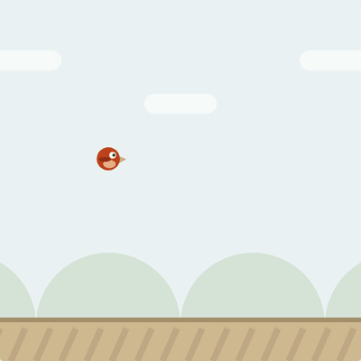
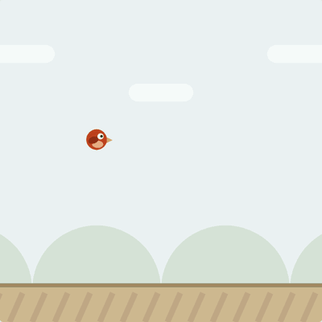
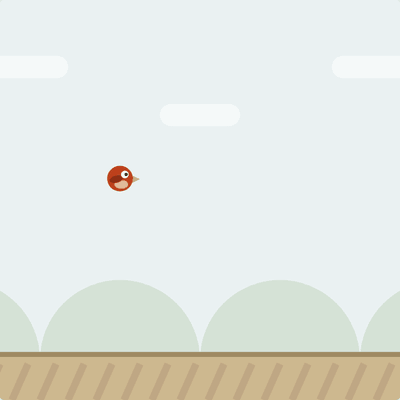
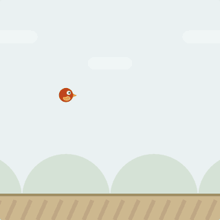

# jev-flap

[jev](https://typesafe.ai) に [OpenGames](https://github.com/opengames-dev/opengames-dev.github.io) の Flap をブラウザの画面だけ見てプレイさせる実験。ローカルで動かす [LiquidAI/d1-3B](https://huggingface.co/LiquidAI/d1-3B) にも対応している。


## 実行

```sh
git submodule update --init
uv sync
uv run playwright install chromium
uv run python scripts/01_first_attempt.py
```

実験は `scripts/` に1実験1ファイルで置いていて、設定はファイル内に書いてある（引数なし）。結果は `outputs/<スクリプト名>/` に出る。jev を使う実験は `uv run --env-file .env python scripts/...` で実行する。

## Attempts

| Attempt | プレイ動画（等倍速） | スコア | メモ |
|---|---|---|---|
| first attempt |  | 0 / 0 / 0 | 画面に関係なく毎ターン flap し、天井まで上がって土管にぶつかる |
| 閾値 0.57 |  | 1 / 0 / 0 | P(flap) が上がるのは鳥が地面近くまで落ちたときだけなので、そのタイミングだけ flap して初めて1本通過 |
| 質問を「鳥は隙間の中央より上か下か」に変更 |  | 0 / 1 / 0 | 行動ではなく位置を聞くと、鳥が隙間の中央から離れていれば位置を判定できるようになった。ただ中央より少し下で flap すると跳ね上がりすぎて、上の土管にぶつかる |
| モデルを jev に変更し、鳥の高さ・速度とゲームの物理定数を渡して閾値 0.45 |  | 0 / 1 / 6 | 4フレームを入力に「今 flap すべきか」を聞き、画面から測った鳥の速度も渡す。落ち始めたかどうかを判断できるようになり、初めて6本通過。ただ隙間の位置は知らないので、画面の上の方でも落ち始めると flap して上の土管にぶつかる |
| 隙間の位置も渡す |  | 1 / 0 / 7 | 次の土管と隙間の上端・下端・中央も渡すと7本通過。ただ P(flap) はほぼ鳥が落ちているかどうかで決まり、隙間の位置の影響は小さい。隙間の中央より上でも flap して上の土管にぶつかる |
| 鳥の軌道を描いて「ぶつかるか」を聞く（jev-preview） |  | 0 / 21 / 56 | flap しない場合（青）と今 flap した場合（オレンジ）の0.3秒先までの軌道を画面に描き、それぞれの帯が土管や地面に触れるかを聞く。青がぶつかり、オレンジがぶつからないときに flap して56本通過。数値は使えなかったが、帯が緑に触れているかは正確に見分けられる。0.3秒先しか見ないので、どちらを選んでもぶつかる状況に追い込まれて終わる |
